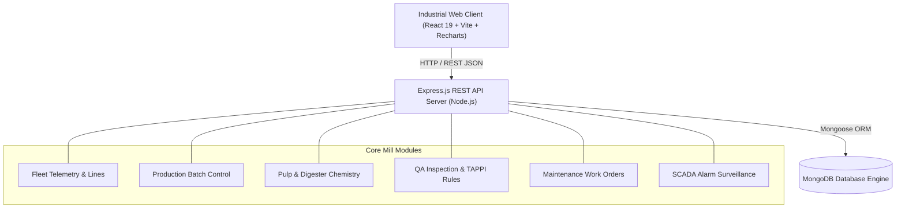

# Smart Paper Mill Management System (SCADA & MES)


> 🚀 **Live Demo**: [https://aravindm30112006.github.io/smart-paper-mill/](https://aravindm30112006.github.io/smart-paper-mill/)

A modern, industrial-grade Operations & Manufacturing Execution System (MES) designed for real-world paper mill plants. Provides real-time SCADA surveillance, machine telemetry, batch production tracking, chemical digester pulp monitoring, quality assurance grading, maintenance scheduling, and active tripwire alarms.

---

## System Architecture



---

## Core Features & Modules

### 1. Operations Control Center (`/`)
- **Executive KPI Strip**: Total gross production (kg), fleet availability ratio, average line utilization, quality pass rate, and critical system alarms.
- **Production Trend Chart**: Interactive Recharts bar visualization displaying output weight per batch with grade metadata.
- **Quality Distribution Donut**: Pass / Warning / Fail inspection distribution with centered real-time pass percentage.
- **Live Fleet Telemetry**: Real-time status indicators (`Running`, `Maintenance`, `Idle`, `Offline`), operating temperatures ($\ge 85^\circ\text{C}$ threshold warnings), and utilization gauges.
- **Active Alarm Feed**: Immediate visibility into critical conditions and operational warnings.
- **Maintenance Schedule & Audit Trail**: Upcoming technician dispatches and reverse-chronological plant activity feed.

### 2. Machinery & Production Lines (`/machines`)
- Multi-line tracking across Paper Machine units (operating hours, thermal profiles, utilization percentages).
- **Dual View Modes**: Switch seamlessly between **Telemetry Grid Cards** and high-density **Enterprise Table View**.
- Live search and status filter tabs (`All Units`, `Running`, `Maintenance`, `Idle`).
- Machine registration and inline parameter reconfiguration drawer.

### 3. Production Batch Tracking (`/production`)
- Track finished paper roll output across grades (`A4`, `A3`, `A5`, `Newsprint`, `Packaging`).
- Machine line allocation, scheduled production run dates, and output weight tracking.
- Fast multi-grade filtering and search.

### 4. Pulp Digestion & Chemistry (`/pulp`)
- **Live Process Spotlight**: Immediate readouts for slurry temperature, hydraulic head pressure (bar), fiber moisture (%), pH balance (0–14), and flow rate (L/min).
- Historical digester logs with threshold categorization (`Normal`, `Warning`, `Critical`).

### 5. Quality Assurance & Compliance (`/quality`)
- Laboratory test recording: caliper thickness (mm), moisture content (%), tensile burst strength (kN/m), and roll defect counts.
- **Automated TAPPI/ISO Grading Matrix**:
  - **PASS (Grade A)**: 0 – 5 defects (cleared for dispatch)
  - **WARNING (Grade B)**: 6 – 10 defects (requires secondary inspection)
  - **FAIL (Reject)**: $>10$ defects (batch quarantine and repulping route)

### 6. Maintenance & Technician Work Orders (`/maintenance`)
- Work order dispatching for `Preventive`, `Corrective`, and `Emergency` procedures.
- Technician assignment, scheduled shutdown windows, completion dates, and status pills (`Scheduled`, `In Progress`, `Completed`, `Overdue`).

### 7. Alarm Console & Tripwire Rules (`/alerts`)
- Dedicated safety console categorizing system alerts by severity.
- Automated sensor threshold surveillance (Thermal excursions, Low utilization tripwires, QA failures, Overdue maintenance).

---

## Tech Stack

### Frontend (`client/`)
- **Framework**: React 19 + Vite 8
- **Routing**: React Router DOM v7
- **Data Visualization**: Recharts v3
- **Icons**: Lucide React
- **HTTP Client**: Axios
- **Styling**: Industrial CSS Design System with CSS Custom Properties, Inter typography, and responsive breakpoints ($1920\text{px}$, $1440\text{px}$, $1366\text{px}$, $1024\text{px}$, $768\text{px}$, $480\text{px}$).

### Backend (`server/`)
- **Runtime**: Node.js
- **Framework**: Express.js 5
- **Database**: MongoDB via Mongoose 9
- **CORS & Environment**: CORS, Dotenv

---

## Getting Started

### Prerequisites
- Node.js (v18 or higher recommended)
- MongoDB instance running locally (e.g. `mongodb://localhost:27017/smart-paper-mill`) or MongoDB Atlas URI

---

### 1. Server Setup

```bash
cd server
npm install
```

Configure `.env` in the `server` directory (optional defaults provided in `server/config/db.js`):
```env
PORT=5000
MONGO_URI=mongodb://localhost:27017/smart-paper-mill
```

Start the backend server:
```bash
npm start
# or for live reloading:
npm run dev
```
The server will bind to `http://localhost:5000`.

---

### 2. Frontend Client Setup

```bash
cd client
npm install
npm run dev
```
The frontend dev server will launch at `http://localhost:5173`.

To verify or generate a production bundle:
```bash
npm run build
```

---

## REST API Reference

| Endpoint | Method | Description |
| :--- | :---: | :--- |
| `/api/machines` | `GET`, `POST` | List all machines or register a new unit |
| `/api/machines/:id` | `PUT`, `DELETE` | Update parameters or remove machine |
| `/api/production` | `GET`, `POST` | Retrieve production batches or log new run |
| `/api/production/:id` | `PUT`, `DELETE` | Update or delete batch record |
| `/api/pulp` | `GET`, `POST` | Read chemical digester metrics or log readings |
| `/api/pulp/:id` | `PUT`, `DELETE` | Update or delete pulp data |
| `/api/quality` | `GET`, `POST` | Get QA inspections or submit new test sheet |
| `/api/quality/:id` | `PUT`, `DELETE` | Update or delete inspection record |
| `/api/maintenance` | `GET`, `POST` | Fetch work orders or schedule maintenance |
| `/api/maintenance/:id` | `PUT`, `DELETE` | Update status/completion or delete ticket |
| `/api/alerts` | `GET` | Aggregated system alarms and threshold tripwires |

---

## Industrial Color Palette & UI Tokens

| Token | Hex | Usage |
| :--- | :--- | :--- |
| `--brand-navy` | `#0b1526` | Fixed sidebar, brand identity |
| `--brand-blue` | `#1e40af` | Primary action buttons, chart fills |
| `--bg-canvas` | `#f4f6f9` | Main layout background |
| `--status-running` | `#16a34a` | Nominal machine states, PASS inspections |
| `--status-maintenance` | `#d97706` | Warnings, ongoing maintenance, Grade B QA |
| `--status-critical` | `#dc2626` | Thermal trips, quality rejects, urgent alarms |

---

## License
MIT License. Created for Smart Paper Mill Manufacturing Operations.
